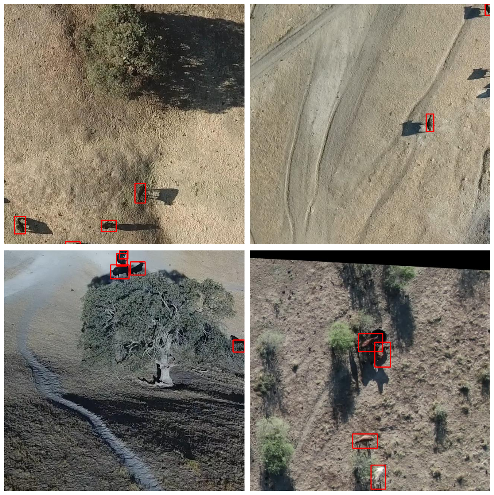
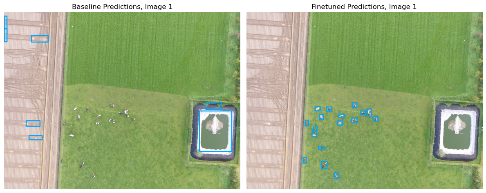

# Prebuilt models

DeepForest comes with prebuilt models to help you get started. These models are available on Hugging Face and are loaded using the `load_model` function, they always are seen as the starting point for further training, rather than a general purpose tool for new imagery.

## Demo

The prebuilt models can be viewed on the hugging face demo. These are for individual images only using the predict_image function. Large files that would typically be run with predict_tile and cut into smaller pieces will not produce accurate results.

https://huggingface.co/spaces/weecology/deepforest-demo

## Tree Crown Detection model

The model was initially described in [Remote Sensing](https://www.mdpi.com/2072-4292/11/11/1309) on a single site. The prebuilt model uses a semi-supervised approach in which millions of moderate quality annotations are generated using a LiDAR unsupervised tree detection algorithm, followed by hand-annotations of RGB imagery from select sites. Comparisons among geographic sites were added to [Ecological Informatics](https://www.sciencedirect.com/science/article/pii/S157495412030011X). The model was further improved, and the Python package was released in [Methods in Ecology and Evolution](https://besjournals.onlinelibrary.wiley.com/doi/full/10.1111/2041-210X.13472).


```python
from deepforest import main

m = main.deepforest()
m.load_model(model_name="weecology/deepforest-tree")
```

The model that is specified in the configuration (see [Configuration](09_configuration_file.md)) will be loaded when you create a `deepforest` object. By default, this is `weecology/deepforest-tree`. However here we've explicitly called `load_model` for demonstration.

### Citation
> Weinstein, B.G.; Marconi, S.; Bohlman, S.; Zare, A.; White, E. Individual Tree-Crown Detection in RGB Imagery Using Semi-Supervised Deep Learning Neural Networks. Remote Sens. 2019, 11, 1309

## Bird Detection model

The model was initially described in [Ecological Applications](https://esajournals.onlinelibrary.wiley.com/doi/abs/10.1002/eap.2694). From the abstract

>
 Using over 250,000 annotations from 13 projects from around the world, we develop a general bird detection model that achieves over 65% recall and 50% precision on novel aerial data without any local training despite differences in species, habitat, and imaging methodology. Fine-tuning this model with only 1000 local annotations increases these values to an average of 84% recall and 69% precision by building on the general features learned from other data sources.
 >


 ### Citation
> Weinstein, B.G., Garner, L., Saccomanno, V.R., Steinkraus, A., Ortega, A., Brush, K., Yenni, G., McKellar, A.E., Converse, R., Lippitt, C.D., Wegmann, A., Holmes, N.D., Edney, A.J., Hart, T., Jessopp, M.J., Clarke, R.H., Marchowski, D., Senyondo, H., Dotson, R., White, E.P., Frederick, P. and Ernest, S.K.M. (2022), A general deep learning model for bird detection in high resolution airborne imagery. Ecological Applications. Accepted Author Manuscript e2694. https://doi-org.lp.hscl.ufl.edu/10.1002/eap.2694


```python
from deepforest import main

# Load deepforest model and set bird label
m = main.deepforest()
m.load_model(model_name="weecology/deepforest-bird")

# Alternatively, via configuration:
config_args = {
  "model": {"name": "weecology/deepforest-bird"}
}
m = main.deepforest(config_args=config_args)

```


We have created a [GPU colab tutorial](https://colab.research.google.com/drive/1e9_pZM0n_v3MkZpSjVRjm55-LuCE2IYE?usp=sharing
) to demonstrate the workflow for using the bird model.

### Getting Started with DeepForest Bird Detection Model

```{raw} html
<div style="position: relative; padding-bottom: 62.5%; height: 0;">
  <iframe
    src="https://www.loom.com/embed/0039ee541e174180a52cfe9e85228358?sid=d44c25cc-e1bc-46fe-833b-e9c87193e32c"
    frameborder="0"
    webkitallowfullscreen
    mozallowfullscreen
    allowfullscreen
    width="640"
    height="360">
  </iframe>
</div>
```

For more information, or specific questions about the bird detection, please create issues on the [BirdDetector repo](https://github.com/weecology/BirdDetector)

## Livestock Detectors model

This model has a single label 'cattle' trained on drone imagery of cows, sheep and other large mammals in agricultural settings.



The model was improved by @camappel and a nice notebook illustrates its improvement here: https://edsbook.org/notebooks/gallery/95199651-9e81-4cae-a3a7-66398a9a5f62/notebook.



```python
from deepforest import main

# Load deepforest model and set bird label
m = main.deepforest()
m.load_model(model_name="weecology/deepforest-livestock")

# Alternatively, via configuration:
config_args = {
  "model": {"name": "weecology/deepforest-livestock"}
}
m = main.deepforest(config_args=config_args)
```

## Crop Classifiers model

Crop models are classification models (e.g. ResNets) that are applied to cropped predictions as a secondary processing step. Although you could train a single object detection model for fine-grained classification, it is often much easier to take a prebuilt model for tree detection and then train a classifier on a smaller high-quality dataset. For information on how to use crop models, see the Crop Models section.


### Alive/Dead trees model

`weecology/cropmodel-deadtrees` classifies each predicted tree crown as `Alive` or `Dead` from RGB. It is a ResNet-50 that is first pretrained on about 250,000 crowns from the [deadtrees.earth](https://deadtrees.earth) aerial dataset ([DTE-aerial](https://arxiv.org/abs/2605.19605), CC BY part) and then fine-tuned on 6,329 hand-labelled NEON crown crops from 41 sites.

- **Pretraining crowns**: DeepForest detects crowns on 0.1 m deadtrees.earth patches. A crown is labelled Dead when at least 50% of its box is mapped as tree mortality, and Alive when it has no mortality and at least 70% tree cover.
- **Hand labels**: NEON crops are split into train, validation and test by 1 km tile, so no tile is in more than one split.
- **Evaluation**: the NEON test split (882 crops, 136 dead) and 2,841 crowns from the 25 expert-labelled sites of the [DTE-aerial benchmark](https://huggingface.co/datasets/ayushi3536/deadtree.earth-aerial-bench). Neither was used for training.

| Model | NEON test AUROC | NEON test Dead F1 | DTE benchmark AUROC | DTE benchmark Dead F1 |
|---|---|---|---|---|
| NEON hand labels only | 0.965 | 0.87 | 0.930 | 0.47 |
| deadtrees.earth pretraining + NEON fine-tuning | 0.985 | 0.87 | 0.983 | 0.84 |

Dead F1 uses a 0.5 threshold. The model is conservative: lowering the Dead threshold to 0.2 raises Dead recall from 0.73 to 0.82 on the DTE benchmark (precision 0.99 to 0.98) and from 0.85 to 0.93 on NEON test (precision 0.89 to 0.81). The mortality class describes visible symptoms (leaf loss, grey or brown crowns), not physiological death, and can be confused with leaf-off deciduous trees, shadows or pale-crowned species.

```python
from deepforest import main
from deepforest.model import CropModel

m = main.deepforest()
m.load_model("weecology/deepforest-tree")
crop_model = CropModel.load_model("weecology/cropmodel-deadtrees")
predictions = m.predict_tile(path="tile.tif", crop_model=crop_model)
```

The training pipeline, from data sources to evaluation, is in [`scripts/alive_dead`](https://github.com/weecology/DeepForest/tree/main/scripts/alive_dead).

The first version of this model (trained on the NEON hand labels only) is described in:

Citation: Weinstein, Ben G., et al. "Capturing long‐tailed individual tree diversity using an airborne imaging and a multi‐temporal hierarchical model." Remote Sensing in Ecology and Conservation 9.5 (2023): 656-670.

### NEON Tree Species and Genus Classification

Two ResNet-18 crop classifiers trained on RGB crown images from the National Ecological Observatory Network (NEON). The training data includes deduplicated hand-annotated tree crowns from 29 NEON sites across the US.

- **Species model**: 148 species classes, trained on ~16k deduplicated crown crops. HuggingFace repo: `weecology/cropmodel-tree-species`
- **Genus model**: 54 genus classes, same training data aggregated to genus level. HuggingFace repo: `weecology/cropmodel-tree-genus`

Both models use a torchvision ResNet-18 backbone pretrained on ImageNet and fine-tuned on NEON RGB data. Input images are resized to 224x224 using nearest-neighbor interpolation (`resize_interpolation: nearest` in the model config) and normalized with standard ImageNet statistics. The interpolation mode is loaded automatically from the HuggingFace config — no user action required.

```python
from deepforest.model import CropModel

# Load the species classifier
species_model = CropModel.load_model("weecology/cropmodel-tree-species")

# Load the genus classifier
genus_model = CropModel.load_model("weecology/cropmodel-tree-genus")
```

Use these as a second stage after tree crown detection: detect crowns with a DeepForest model, then classify each crop.

For more details on the training data and code, see [NeonTreeClassification](https://github.com/GatorSense/NeonTreeClassification).

## Want more pretrained models?

Please consider contributing your data to open source repositories, such as zenodo or lila.science. The more data we gather, the more we can combine the annotation and data collection efforts of hundreds of researchers to built models available to everyone. We welcome suggestions on what models and data are most urgently [needed](https://github.com/weecology/DeepForest/discussions).
